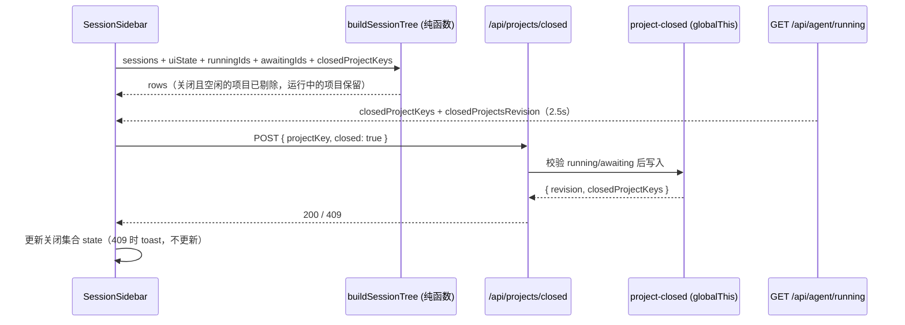

# 设计 — 侧栏关闭项目（不删除会话）

## 决策记录

### D1 关闭集合只存在进程内存里

- 选择: 新模块 `lib/project-closed.ts`，`globalThis` 上以 `Symbol.for("pi-web:closed-projects")` 取一个 `{ keys: Set<string>; revision: number }`，形状照 `lib/mcp-status.ts`。进程重启即忘；dev 热重载不丢。
- 理由: 需求就是"只在当前进程生效"；`Symbol.for` 保证 route 分包与 HMR 复用同一份。
- 备选: 写进 `pi-web-session-state.json`（现有 pin/archive/顺序/名字的持久化文件）。
- 否决理由: 那会跨重启、跨 pi-web 实例共享且永久保留，与需求相反；也会污染"用户选择"语义，并让"重新打开后顺序/名字自动复原"不再成立（要额外清理）。

### D2 关闭/打开一个带 revision 的接口

- 选择: `app/api/projects/closed/route.ts`
  - `GET` → `{ closedProjectKeys: string[], revision: number }`
  - `POST { projectKey: string, closed?: boolean }`（缺省 `closed: true`）→ `200 { revision, closedProjectKeys }`；`closed: false` 用于重开。
  - `409 { error, reason: "running" }` 拒绝关闭；`400 invalid-request`；其余守卫照仓库惯例（`isApiRequestAllowed` 403、`hasJsonContentType` 415）。
- 理由: 一个 revision 源，客户端只需要"看见它就换一份集合"。
- 备选: close / reopen 两个路由。
- 否决理由: 两处 revision 计数迟早漂移，且客户端要合并两份快照。

### D3 运行中/等待输入时拒绝关闭（客户端禁用 + 服务端权威）

- 选择: 纯函数 `projectCloseBlock(input, projectKey)` 放在 `lib/sidebar-actions.ts`：`listSessionFamilies()` 里属于该 key 的 family，任一成员在 `runningIds` 或 `awaitingIds` 中就用它算出 `{ blocked: true, reason: "awaiting" | "running" }`（`awaiting` 优先）。菜单项用 `disabled` + `disabledReason`（`components/SidebarMenu.tsx` 已支持）。POST 路由自己再查一次：`getRunningRpcSessionIds()` / `getAwaitingInputRpcSessionIds()` 与 `listAllSessions({ allowStale: true })` + `getRpcSessionInfos({ includeTransient: true })` 合并后的会话表做 id→`projectKey` 比对。
- 理由: 轮询 2.5s 有窗口；别的标签页可能刚开跑。服务端是唯一权威。
- 备选: 只靠客户端禁用。
- 否决理由: 菜单打开的瞬间到点击之间可以开始运行，会留下一个"关闭了却还在跑"的项目。

### D4 关闭后被关闭项目跑起来就自动显示

- 选择: 关闭标记不清除。树里判定"隐藏"的条件是 `closed && 该项目没有任何 running/awaiting 成员`，与 `isFamilyArchived()` 的"运行中的 family 不算归档"同构。跑完自动再隐藏。
- 理由: 用户要"挡着"运行中的项目，而关闭之后才跑起来的情形无法被点击时拦截；让它可见是唯一不会让用户丢掉对话框的做法。
- 备选: 运行开始时清除关闭标记。
- 否决理由: 跑完就回不去了，等于"关一次只能撑到下一次运行"。
- 备选: 关闭后跑起来仍然隐藏。
- 否决理由: `ctx.ui.*` 的对话框会停在用户永远看不到的会话里。

### D5 关闭优先于置顶，且不动置顶标记

- 选择: `buildSessionTree()` 在收集项目 key 前就剔除"关闭且空闲"的项目：主 family 循环里 `continue`（连归档计数都不加）、`currentProject` 与 `Object.keys(uiState.projects)` 的 `addKey` 都不加；`buildArchiveRows()` 同样跳过。
- 理由: 一个过滤点，天然覆盖置顶家族、置顶项目、归档视图与计数。
- 备选: 关闭时顺手取消置顶。
- 否决理由: 那会写 `pi-web-session-state.json`，重开后置顶回不来，且违反"进程内状态不碰磁盘"。

### D6 关闭当前项目：先切 cwd 再关，迁移有三级兜底

- 选择: 顺序固定为 ①算出目标 cwd 并落实 → ②`POST` 关闭。目标：
  1. `POST /api/default-cwd` 拿到 `~/pi-cwd/YYYYMMDD`，再 `POST /api/cwd/validate`；若校验失败或它的 `projectKey` 等于正在关闭的 key（今天就在用这个目录），进下一步；
  2. `model.projects` 顺序里第一个未关闭、且有关活会话的项目 → 选它 `latestModified` 最新的 family 的 root（`handleSelectSessionFromList()`）；
  3. 都没有 → 停在默认目录的空输入框（`setSelectedCwd(defaultCwd)` 让 AppShell 换新 composer）。
- 理由: 树里 `currentProject` 是无条件 `addKey` 的，先关后挪会闪一下"关了又回来"。
- 备选: 先 POST 再挪 cwd，失败就回滚。
- 否决理由: 回滚要恢复关闭前的 UI 状态（cwd、composer、文件 Tab），成本远高于"先挪后关"；而且挪 cwd 本身不会失败到需要回滚的程度（挪不动就走下一级兜底）。
- 已接受副作用: 默认目录会成为当前项目，侧栏因此多出一个"今天"的空分组。

### D7 "显示什么"全部留在 `lib/session-tree.ts` 的纯函数里

- 选择: `SessionTreeInput`（以及归档视图的入参类型）新增可选 `closedProjectKeys?: ReadonlySet<string>`；`buildSessionTree` / `buildArchiveRows` 内部先把"关闭且无运行成员"算成一个 `hiddenKeys` 集合，再按 D5 剔除。组件只负责把数据传进来。
- 理由: 仓库约定（AGENTS.md：判断都在纯函数、组件只渲染），且 `lib/session-tree.test.mjs` 能覆盖全部分支。
- 备选: 在 `components/SessionSidebar.tsx` 过滤 `allSessions`。
- 否决理由: 会连带影响搜索、最近项目、统计等所有读 `allSessions` 的地方，并且绕开现有测试。

### D8 客户端通过已有的 2.5s 轮询同步

- 选择: `GET /api/agent/running` 响应新增 `closedProjectKeys: string[]` 与 `closedProjectsRevision: number`；侧栏轮询读入 state，`POST` 的响应也直接落到同一个 state（本轮不必等下一次轮询）。state 只在 revision 变化时替换。
- 理由: 那条通道已经在给多标签页同步 pin/archive（`sessionUiStateRevision`），零新机制。
- 备选: 单独轮询 `/api/projects/closed`。
- 否决理由: 多一条常驻请求，且与 running 状态的刷新时机错开会产生"刚关掉又闪回来"。

### D9 重新打开 = 该项目变成当前项目

- 选择: 抽一个 `reopenIfClosed(projectKey)`（未关闭时直接返回）。调用点：
  - 显式：`handleFilesPick`、`commitCustomPath` 的 files 分支、`handleSelectSessionFromList`、`startNewSessionIn`；
  - 兜底 effect：`currentProjectKey` 发生变化且新 key 在关闭集合里时调用，覆盖深链/恢复等路径。
  - 防自伤：关闭当前项目的流程里用 `closingKeyRef` 标记正在关闭的 key，effect 与显式调用都跳过它，直到 `POST` 返回后清空（避免"刚关就被自己重开"）。
- 理由: 四条热路径显式、可读、可测；effect 只兜没覆盖到的路径。
- 备选: 只做 effect。
- 否决理由: 关闭当前项目时 cwd 先变、关闭后到，effect 会把刚关的项目立刻重开。

### D10 项目列表保留已关闭项目并标记

- 选择: `projectChoiceList` 不剔除已关闭项目（它们本来就在 `recentProjects` 里），给 `ProjectChoice` 之外的展示层加一个"已关闭"标记：选择器菜单的行 note 用 i18n 新键显示；选中即按 D9 重开。
- 理由: 否则一个"没有置顶、会话全被归档过"的项目关掉后就再也没有入口。
- 备选: 从选择器里也剔除。
- 否决理由: 会让用户失去唯一的找回入口，只能手输路径。

## 数据流转图



## 接口契约

```ts
// lib/project-closed.ts —— 服务端进程内存
export function getClosedProjectKeys(): string[];
export function getClosedProjectsRevision(): number;
export function setProjectClosed(projectKey: string, closed: boolean): { revision: number; closedProjectKeys: string[] };
export function isProjectClosed(projectKey: string): boolean;
export function resetClosedProjectsForTests(): void;   // revision 归 0、集合清空

// app/api/projects/closed/route.ts
GET  -> { closedProjectKeys: string[], revision: number }
POST body { projectKey: string, closed?: boolean }
  200 -> { revision: number, closedProjectKeys: string[] }
  400 -> { error: string }
  403 -> { error: string }
  409 -> { error: string, reason: "running" }
  415 -> { error: string }

// lib/session-tree.ts
interface SessionTreeInput { /* 现有字段 */ closedProjectKeys?: ReadonlySet<string> }
// buildArchiveRows 的入参类型同样带上 closedProjectKeys?: ReadonlySet<string>

// lib/sidebar-actions.ts
export function projectCloseBlock(
  input: Pick<SessionTreeInput, "sessions" | "runningIds" | "awaitingIds">,
  projectKey: string,
): { blocked: false } | { blocked: true; reason: "awaiting" | "running" };
```

i18n 新键（三个 locale 都要有）：`sidebar.closeProject`、`sidebar.closedProject`（选择器标记）、`sidebar.closeProjectBlockedRunning`、`sidebar.closeProjectBlockedAwaiting`、`sidebar.closeProjectFailed`（toast，`{ error }`）。

## 依赖与全局假设

- 侧栏已有的 2.5s `GET /api/agent/running` 轮询在所有标签页可见时运行；`awaitingInputSessionIds` 由 `AgentSessionWrapper.isAwaitingInput()` 提供。
- `listAllSessions({ allowStale: true })` 会返回上一份扫描结果并在后台重建，够用于关闭前的忙碌校验；`getRpcSessionInfos({ includeTransient: true })` 能补上刚开跑、文件还没落盘的会话。
- `projectKey` 是项目级标识（`attachSessionProjectInfo()` 的 `projectIdentityKey(projectRoot)`），worktree 与主检出共享同一个 key。
- 关闭集合是纯内存，**不**参与 `sessionListVersion`，所以关闭/重开都不该触发会话列表重扫。
- 现有测试用 `node:test` + `jiti` 直接 import TS，`lib/session-tree.test.mjs` 有 `session()/subagent()/uiState()` 构造器可复用。
