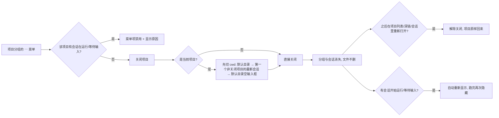

# 需求说明 — 侧栏关闭项目（不删除会话）

## 问题

侧栏按项目分组列出会话。项目一旦出现在列表里就永远在：会话多的用户每次都要滚过一堆不再需要的目录，而"归档"只能逐条归档会话，删掉又会真删文件。当前没有任何"把这个目录从列表里拿掉、但会话都还在"的手段。

## 目标

用户能把一个项目从侧栏关掉（分组和会话一起消失、文件一个不删），之后从项目列表重新打开时它原样回来。

## 范围

### 做什么

- 项目分组菜单新增"关闭项目"。
- 关闭后该项目的分组、会话从会话树和归档视图里消失，不计入底部 Archived 计数。
- 关闭状态只存在于当前 node 进程内：刷新页面仍在，重启 pi-web 进程即消失。
- 关闭在项目有会话正在运行或等待用户输入时被拒绝（菜单项禁用并给出原因；服务端权威校验）。
- 关闭后被关闭项目里有会话开始运行/等待输入时，该项目自动重新显示，运行结束后再次隐藏，关闭标记保留。
- 关闭优先于置顶：已置顶项目被关闭后不因置顶而回流，磁盘上的置顶标记不动。
- 关闭当前项目时，先切走 cwd：默认目录优先，取不到则选第一个非关闭项目里最新的会话，都没有就停在默认目录的空输入框。
- 重新打开：任何让该项目成为当前项目的动作都解除关闭（项目列表选中、点击它的会话、深链、在其中新建会话）。
- 关闭项目时它的文件/终端 Tab 按普通项目切换的方式驻留。

### 不做什么

- 不删除、不移动、不重写任何会话 `.jsonl`，不改 `pi-web-session-state.json`（置顶/归档/项目顺序/项目名一律不动）。
- 不做持久化开关、不做跨进程/跨实例同步、不做白名单。
- 不做 worktree 级关闭（关闭粒度是 `projectKey`，同一项目的 worktree 一并关闭）。
- 不新增"已关闭项目"列表视图、不做批量关闭、不做按时间自动关闭。
- 不改搜索接口：搜索命中被关闭项目的会话时，点击即按"重新打开"处理（不额外标记）。

## 验收标准

- A1：项目分组菜单里有"关闭项目"；点击后该分组与它的会话从会话树消失，归档视图里也不出现，底部 Archived 计数不含它们，会话文件仍存在。
- A2：该项目有会话在运行或等待输入时，菜单项禁用并在右侧显示原因；绕过 UI 直接 `POST /api/projects/closed` 返回 409 且页面给出提示。
- A3：关闭后让该项目里某个会话开始运行（另一个标签页或看板），该项目自动重新出现在树里；运行结束后再次消失，无需再点一次关闭。
- A4：关闭一个已置顶的项目，它不会因为置顶而在侧栏顶部（或分组里）回流；重新打开后置顶仍然生效。
- A5：关闭当前项目时 cwd 按顺序迁移：默认目录（`POST /api/default-cwd` + `/api/cwd/validate`）→ 第一个非关闭项目里最新的会话 → 都没有时停在默认目录的空输入框；迁移完成后被关闭项目才消失。
- A6：刷新页面关闭状态仍在；重启 pi-web 进程后所有项目重新出现。
- A7：项目列表里被关闭的项目仍在，并带"已关闭"标记；选中它（或点它的会话、用 `?cwd=`/`?session=` 深链、在其中新建会话）后关闭状态解除，项目回到原来的位置、名字和置顶状态。
- A8：`npm test`、`node_modules/.bin/tsc --noEmit`、`npm run lint` 全部通过。

## 用户视角流程图

